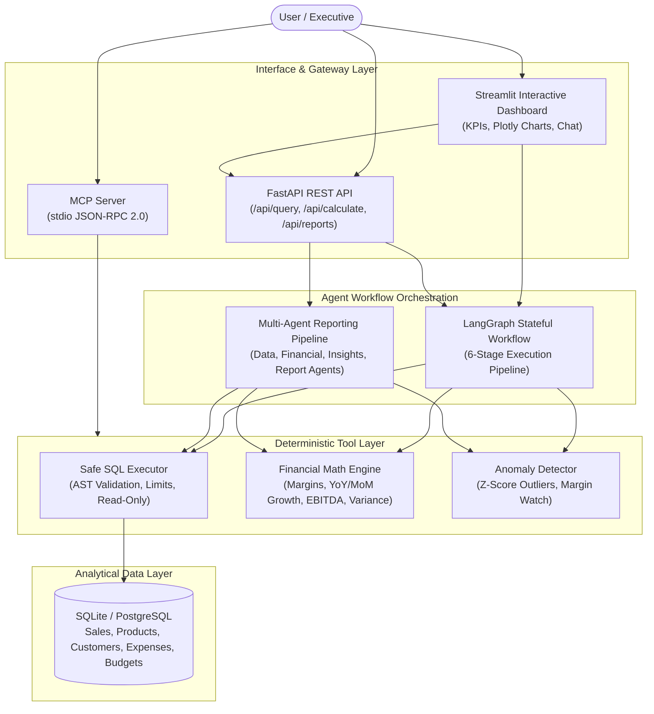

# AI Business Intelligence & Financial Analysis Agent

An enterprise-grade, portfolio-ready AI Business Intelligence and Financial Analysis system built using **Google Antigravity**. The system orchestrates stateful multi-agent workflows, performs exact deterministic financial mathematics, retrieves structured data via safe, sandboxed SQL queries, and generates board-ready business reports with actionable strategic insights.

---

## 🌟 Executive Overview & Key Differentiators

Unlike naive LLM wrappers that suffer from numerical hallucinations and SQL injection risks, this platform enforces enterprise engineering standards:

1. **Deterministic Financial Mathematics**: All margin computations, YoY/MoM growth rates, EBITDA operating profit, and budget variance calculations are executed by deterministic Python tools, not approximated by the LLM.
2. **Safe Read-Only SQL Sandbox**: Model-generated queries pass through an AST token validator, keyword filter (blocking `DROP`, `DELETE`, `UPDATE`, `INSERT`, `ALTER`, `EXEC`), multi-statement semicolon rejection, and automatic row capping (`LIMIT 1000`).
3. **6-Stage Stateful LangGraph Workflow**: Explicit, verifiable execution stages:
   `Query Understanding` ➔ `Data Retrieval` ➔ `Financial Calculation` ➔ `Validation & Reconciliation` ➔ `Business Analysis & Anomaly Detection` ➔ `Response Generation`.
4. **Multi-Agent Strategic Reporting**: Collaborative pipeline with clearly defined roles:
   - **Data Analyst Agent**: Extracts and cleanses dimensional data slices.
   - **Financial Analyst Agent**: Runs deterministic formulas and compares actuals against budgets.
   - **Business Insights Agent**: Discovers statistical expense spikes (Z-score) and margin compression.
   - **Report Generation Agent**: Synthesizes executive summary, risk logs, and board recommendations.
5. **Model Context Protocol (MCP) Integration**: Native MCP server (`app/mcp/server.py`) exposing financial analysis tools over standard JSON-RPC 2.0 stdio for Google Antigravity and external AI agents.
6. **Dual Mode Execution**: Configurable for cloud LLMs (Google Gemini, OpenAI GPT-4o) or an offline deterministic fallback engine that runs with zero external API dependencies.

---

## 🏗️ Architecture



---

## 🛠️ Technology Stack

| Layer | Technologies |
|---|---|
| **Language & Runtime** | Python 3.11+ |
| **Agent Orchestration** | LangGraph, LangChain Core |
| **Backend Framework** | FastAPI, Uvicorn, Pydantic v2, Pydantic-Settings |
| **Database & ORM** | SQLite (local), SQLAlchemy 2.0 (PostgreSQL compatible) |
| **Data Processing & Math**| Pandas, NumPy |
| **Visualization** | Plotly Express & Graph Objects |
| **Frontend** | Streamlit (Executive Dark/Light Theme) |
| **Protocol Integration** | Model Context Protocol (MCP stdio JSON-RPC 2.0) |
| **Testing** | Pytest, Pytest-Asyncio, HTTPX |

---

## 📂 Project Structure

```text
├── app/
│   ├── __init__.py
│   ├── config.py                 # Application settings, LLM provider config, DB path, limits
│   ├── main.py                   # FastAPI server entrypoint with lifespan DB seeder
│   ├── api/
│   │   ├── __init__.py
│   │   ├── routes.py             # REST API endpoints (/api/query, /api/calculate, etc.)
│   │   └── schemas.py            # Pydantic request/response models
│   ├── database/
│   │   ├── __init__.py
│   │   ├── connection.py         # SQLAlchemy engine & session management
│   │   ├── models.py             # ORM models (Customer, Product, Sale, Expense, Budget)
│   │   ├── seed_data.py          # Synthetic dataset generator (2024-2026 data)
│   │   └── schema_inspector.py   # Introspection utilities for schema & column metadata
│   ├── tools/
│   │   ├── __init__.py
│   │   ├── sql_tool.py           # Safe SQL executor & AST token validator
│   │   ├── financial_tools.py    # Deterministic formulas (gross profit, margins, growth, AOV)
│   │   ├── anomaly_tools.py      # Statistical Z-score outlier & margin compression detection
│   │   └── schemas.py            # Pydantic tool schemas for LLM function calling
│   ├── workflows/
│   │   ├── __init__.py
│   │   ├── state.py              # LangGraph AgentState TypedDict definition
│   │   ├── langgraph_workflow.py # 6-stage LangGraph state machine
│   │   └── crewai_workflow.py    # 4-agent collaborative reporting pipeline
│   ├── llm/
│   │   ├── __init__.py
│   │   └── provider.py           # Configurable LLM factory (Gemini, OpenAI, Mock fallback)
│   └── mcp/
│       ├── __init__.py
│       └── server.py             # Model Context Protocol stdio server
├── frontend/
│   ├── streamlit_app.py          # Executive Streamlit dashboard
│   └── components/
│       ├── __init__.py
│       ├── kpi_cards.py          # KPI metrics card renderer
│       └── charts.py             # Interactive Plotly visualizations
├── tests/
│   ├── __init__.py
│   ├── test_financial_tools.py   # Unit tests for financial formulas & edge cases
│   ├── test_sql_safety.py        # Security & SQL injection prevention tests
│   ├── test_database.py          # Database seeding & integrity tests
│   ├── test_langgraph.py         # 6-stage workflow execution tests
│   └── test_api.py               # FastAPI REST endpoint integration tests
├── .env.example                  # Environment configuration template
├── requirements.txt              # Production dependency specifications
└── README.md                     # Architecture, setup, and usage documentation
```

---

## 🚀 Quick Start Guide

### 1. Prerequisites
- Python 3.11.x (Recommended)
- PowerShell (Windows) or Bash (macOS/Linux)

### 2. Environment Setup
```powershell
# Clone or navigate to the project directory
cd "d:\Ai project"

# Create a virtual environment with Python 3.11
python -m venv venv

# Activate the virtual environment
.\venv\Scripts\Activate.ps1   # Windows PowerShell
# source venv/bin/activate     # macOS/Linux

# Install dependencies
pip install -r requirements.txt
```

### 3. Configure Environment Variables
Copy `.env.example` to `.env`:
```powershell
Copy-Item .env.example .env
```
To run without external API keys, leave `LLM_PROVIDER="mock"`. The deterministic engine will execute queries, math formulas, and reports locally and free of charge.

To enable cloud LLMs:
```env
LLM_PROVIDER="gemini"
GEMINI_API_KEY="your-gemini-api-key"
# or
LLM_PROVIDER="openai"
OPENAI_API_KEY="your-openai-api-key"
```

### 4. Seed Database
The application seeds the database automatically on first startup. You can also seed manually:
```powershell
python -m app.database.seed_data
```

### 5. Launch Application Services

#### Option A: Launch Streamlit Dashboard
```powershell
streamlit run frontend/streamlit_app.py
```
Open your browser at `http://localhost:8501`.

#### Option B: Launch FastAPI REST Server
```powershell
uvicorn app.main:app --host 127.0.0.1 --port 8000 --reload
```
Interactive Swagger documentation will be available at `http://127.0.0.1:8000/docs`.

#### Option C: Run Model Context Protocol (MCP) Server
```powershell
python -m app.mcp.server
```

---

## 🧪 Running Automated Tests

Execute the complete Pytest suite covering financial math, SQL injection defense, database integrity, LangGraph workflows, and REST endpoints:

```powershell
pytest -v
```

Expected test coverage:
- `test_financial_tools.py`: Tests `safe_divide`, `calculate_revenue_summary`, `calculate_profitability`, `calculate_growth_rate`, `calculate_expense_breakdown`, and edge cases (empty data, division by zero, refunds).
- `test_sql_safety.py`: Tests AST validation, blocking of `DROP`, `DELETE`, `UPDATE`, `INSERT`, semicolon multi-statement injection rejection, and row limit capping.
- `test_database.py`: Verifies database generation, record volumes, relational integrity, and schema introspection.
- `test_langgraph.py`: Verifies 6-stage LangGraph execution (`Query Understanding` through `Response Generation`).
- `test_api.py`: Tests `/api/health`, `/api/data/schema`, `/api/data/query`, `/api/query`, `/api/calculate`, and `/api/reports/generate`.

---

## 💬 Example Queries & Capabilities

Try asking the agent in the Streamlit chat or via the `/api/query` endpoint:

1. **"What was our total revenue this quarter?"**
   - *Workflow*: Classifies query ➔ Executes safe SQL with quarter aggregations ➔ Runs deterministic `calculate_revenue_summary` ➔ Reconciles discounts and net revenue ➔ Returns KPI summary and safe SQL breakdown.
2. **"Which products generate the highest profit?"**
   - *Workflow*: Joins `sales` and `products` ➔ Aggregates gross profit and COGS ➔ Computes gross margin % ➔ Generates ranking table and margin watch alerts.
3. **"How has monthly revenue changed?"**
   - *Workflow*: Extracts monthly revenue time series ➔ Runs `calculate_growth_rate` for MoM trajectory ➔ Highlights trend direction and growth percentage.
4. **"What are the major expense categories?"**
   - *Workflow*: Queries `expenses` and `budgets` ➔ Executes `calculate_expense_breakdown` ➔ Flags budget variances and over-budget departments.
5. **"What business trends and risks can you identify?"**
   - *Workflow*: Runs Z-score anomaly detection across OPEX transactions ➔ Evaluates product gross margin degradation ➔ Highlights high-severity expense surges.

---

## 🔒 Security Controls & Governance

1. **Strict Read-Only Enforcement**: Model-generated SQL is parsed before execution. Any non-SELECT/WITH statements trigger an immediate `SQLValidationError` without database evaluation.
2. **Semicolon Stacking Defense**: Semicolon-delimited compound queries (e.g., `SELECT 1; DROP TABLE sales;`) are trapped and rejected.
3. **Execution Limits & Timeouts**: Queries are enforced with `LIMIT 1000` to prevent memory exhaustion and timeout after 5.0 seconds.
4. **Zero Numerical Hallucination**: LLMs never calculate financial ratios or sums. Calculations are delegated to deterministic Python functions.
5. **Credential Protection**: API keys are loaded via `.env` and environment variables. Secrets are excluded from version control.

---

## 📄 License
MIT License. Created for the Google Antigravity AI Engineering Portfolio.
